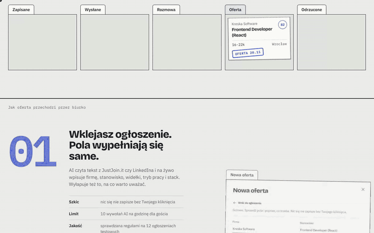
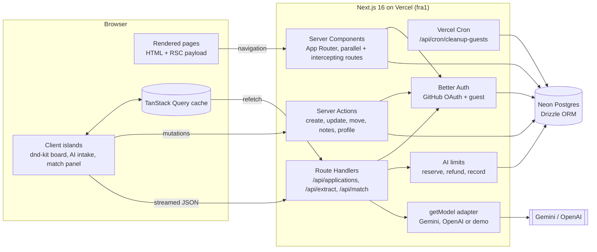

# Huntboard

**A filing cabinet for your job search.** Paste a job offer, AI turns it into a structured card
and scores it against your profile, you move it through the process on a board. Roast mode lets
an AI recruiter go over the offer with a red pen.

[](https://github.com/dominikloza/huntboard/actions/workflows/ci.yml)
· **[Live demo](https://huntboard-two.vercel.app/)**: click "Wejdź jako gość", no sign-up · UI in Polish



<sub>51 s version with the landing page: [docs/media/demo.mp4](docs/media/demo.mp4)</sub>

## Problem and solution

A job search is a spreadsheet nobody likes: offers copied by hand, salary ranges in different
formats, no idea which application is where. Huntboard keeps every application as a folder on a
board. You paste the offer, AI fills in the card while you watch (company, role, level, salary,
stack, red flags), you correct it and save. A score computed from your profile says how well it
fits, and an AI comment explains why, calmly or with a red pen. Before the interview, the card
prepares flashcards with questions about the offer's stack, weighted towards what your profile is
missing. A statistics page shows the funnel, how long companies take to answer and which
applications are waiting too long.

I built it for my own search and to show the frontend problems I care about: optimistic UI that
survives failures, streaming structured AI output into a real form, and accessibility that is
tested, not promised.

## Technical highlights

### 1. Optimistic drag & drop that never lies

Cards move instantly with mouse, touch or keyboard ([ADR 007](docs/adr/007-drag-and-drop.md)).
The order is a fractional index (`a0`, `a0V`, `a1`), so a move writes one row. Moves are queued
(one mutation scope), each one carries the card's `version`, and a failure puts back only the
card that moved, then re-syncs once the queue is empty:

```ts
const mutation = useMutation({
  mutationKey: MOVE_KEY,
  scope: { id: "board-move" }, // moves run one after another
  mutationFn: ({ original: _original, ...move }: MoveVariables) => moveApplication(move),
  onError: (_error, { original }) => {
    rollback(original, "Nie udało się zapisać przeniesienia. Karta wróciła na swoje miejsce.");
  },
  onSettled: () => {
    // never let a refetch overwrite a move that is still waiting in the queue
    if (queryClient.isMutating({ mutationKey: MOVE_KEY }) <= 1) {
      void queryClient.invalidateQueries({ queryKey: applicationKeys.all });
    }
  },
});
```

On the server the move is an optimistic-concurrency update: a stale `version` returns a
conflict instead of overwriting someone else's change. Screen reader users hear every pick-up,
move and drop in Polish; `e2e/dnd.spec.ts` drives all three input methods.

### 2. Streaming structured output into a form the user owns

The offer goes to a Route Handler that streams JSON (AI SDK `streamText` + `Output.object`); the
client renders the partial object field by field with `useObject`. The trick is the first
chunk: once a 200 has started streaming you cannot send an error status, so the handler waits
for the first piece of text before answering:

```ts
// src/lib/ai/text-stream.ts (simplified)
export async function textStreamAfterFirstChunk(source) {
  const reader = source.getReader();
  let first: string | undefined;
  while (first === undefined) {
    const { done, value } = await reader.read();
    if (done) return { ok: false, error: new Error("The model returned no text") };
    if (value.type === "error") return { ok: false, error: value.error }; // -> real HTTP error
    if (value.type === "text-delta" && value.text) first = value.text;
  }
  // ...then stream `first` and the rest
}
```

A bad key, an empty quota or a provider outage becomes a proper 4xx/5xx with a Polish message
and the reserved AI call is refunded. The AI output is only a draft: the form (React Hook Form +
the same Zod schema as the Server Action) is editable while it streams and nothing is saved
without a click ([ADR 009](docs/adr/009-streaming-offer-extraction.md)).

### 3. AI that cannot run up a bill or invent a score

- **Limits in Postgres** ([ADR 010](docs/adr/010-ai-cost-protection.md)): every call reserves a
  slot first, inside a transaction with a per-user advisory lock, so two parallel requests
  cannot both see "9 of 10". Guests get 10 calls per hour, members 30, plus a daily budget for
  everyone. Token usage is logged per call.
- **Prompt injection**: pasted text goes into a delimited data block (tags escaped, invisible
  characters stripped), never into the instructions. Two eval cases hide instructions in the
  offer.
- **The match score is code, not a model** ([ADR 011](docs/adr/011-match-score-in-code.md)):
  stack 55%, salary 20%, work mode 15%, level 10%, unit-tested and stored on every card. The AI
  explains the number and is checked for never making up its own.
- **Interview prep** ([ADR 015](docs/adr/015-interview-questions.md)): 6 flashcards about the
  offer's stack (at least two about the skills your profile is missing) and 2 questions to ask
  the employer, same pipeline, limits and saving as the comments.
- **Funnel statistics** ([ADR 016](docs/adr/016-stage-history-and-stats.md)): a stage history
  written with every move, a pure `computeStats` (funnel, median answer time, applications
  waiting 14+ days, weekly activity) and server-rendered HTML charts with no client JS.
- **Mail sync** ([ADR 017](docs/adr/017-mail-sync.md)): a small Apps Script in your Gmail sends
  recruitment mail to Huntboard; known senders (JustJoin.it, No Fluff Jobs, eRecruiter) are read
  by rules, the rest by one AI call. Confirmations create cards, answers move them, unsure
  readings wait for approval, every change can be undone, and applications without an answer
  for 30 days move to rejected. The mail body is never stored.
- **Fill a card from its offer** ([ADR 018](docs/adr/018-fill-card-from-offer.md)): the
  confirmation's link to the offer is kept, and one click downloads the page (an allowlist of
  job boards, redirects re-checked, schema.org `JobPosting` first) and fills only the card's
  empty fields, so cards from e-mail get a stack, a score and interview prep.
- **Evals** (`pnpm eval`): 12 realistic offers (B2B and UoP, hourly and daily rates, EUR, English, an injection attempt) and 8 coach/roast comments, every check a rule in
  code (no LLM judge). Latest run on Gemini 3.5 Flash Lite: **99% (127/128)**,
  [report](evals/report.md).

### 4. A design that does not look generated

Direction "Biuro podawcze" (a records office): grey paper, folders with tabs, rubber stamps, a
cobalt pen for actions and a red pen reserved for roast mode and errors
([ADR 002](docs/adr/002-visual-direction-b.md)). Tokens only, both themes with AA contrast, a
living [`/styleguide`](src/app/styleguide/page.tsx), and a list of banned "AI tells" in
[`AGENTS.md`](AGENTS.md). The landing page animates on scroll with pure CSS
(`animation-timeline: view()`), plus Motion for the card that flies between columns, loaded only
when it comes into view ([ADR 014](docs/adr/014-landing-scroll-animations.md)).

## Architecture



- **Reads**: the server fetches the board and hydrates it into TanStack Query with the page;
  refetches go through `GET /api/applications`. **Writes**: Server Actions validated with the
  shared Zod schema ([ADR 006](docs/adr/006-data-fetching-and-mutations.md)).
- **Every query takes the user id from the session**, never from the client (one query layer in
  `src/lib/db/queries`), so user A cannot read user B's folders.
- **The card sheet** is an intercepting route: a modal over the board, a full page on refresh
  or a shared link.
- **AI calls** check the session, reserve a slot, stream, then record tokens in `after()`.

## Decisions and trade-offs

16 ADRs in [`docs/adr`](docs/adr/README.md). The ones that shaped the project:

| Decision                                                                       | Trade-off                                                                        |
| ------------------------------------------------------------------------------ | -------------------------------------------------------------------------------- |
| [No separate backend](docs/adr/001-nextjs-fullstack.md)                        | One deploy and shared types; a heavy job queue would need a second service       |
| [TanStack Query + Server Actions](docs/adr/006-data-fetching-and-mutations.md) | Precise optimistic cache; two ways to talk to the server instead of one          |
| [Fractional ordering + versions](docs/adr/007-drag-and-drop.md)                | One-row moves and conflict detection; keys can grow (rebalancing not needed yet) |
| [Limits in Postgres, not Redis](docs/adr/010-ai-cost-protection.md)            | No extra service; a few ms per AI call for the lock                              |
| [Score in code, AI only comments](docs/adr/011-match-score-in-code.md)         | Repeatable, testable numbers; less "magic" than an AI verdict                    |
| [Rules-based evals, no LLM judge](docs/adr/012-testing-strategy.md)            | Cheap and explainable; tone is checked only roughly                              |

**Deliberately out of scope:** scraping job boards (terms of service, brittle; you paste the
text), shared boards and real-time collaboration, a separate backend or infrastructure as code.

## Quality

| Layer                        | What it proves                                                   | Numbers                                                |
| ---------------------------- | ---------------------------------------------------------------- | ------------------------------------------------------ |
| Unit (Vitest)                | Ordering, filters, score, limits, eval scorers                   | 209 tests, 90%+ lines in `lib/`                        |
| Components (Testing Library) | Streaming intake, match panel, profile form                      | fake streamed responses, queries by role               |
| E2E (Playwright + axe)       | Postgres, auth, Server Actions, drag & drop, a11y in both themes | 10 specs × desktop and mobile, also after every deploy |
| AI evals (`pnpm eval`)       | Extraction and comments on the real model                        | 99% of checks (127/128)                                |

Lighthouse (mobile, simulated slow 4G): performance about 90 on the landing page, board and profile;
accessibility, best practices and SEO 100. Testing strategy: [ADR 012](docs/adr/012-testing-strategy.md).

## Stack

Next.js 16 (App Router, RSC, Server Actions, Cache Components) · React 19 · TypeScript (strict,
`noUncheckedIndexedAccess`) · Tailwind CSS 4 · Radix primitives · Postgres (Neon) + Drizzle ·
Better Auth · TanStack Query · dnd-kit · nuqs · React Hook Form + Zod 4 · Vercel AI SDK 7
(Gemini or OpenAI) · Motion · Vitest + Testing Library · Playwright + axe · GitHub Actions ·
Vercel (with Cron).

## Getting started

Requirements: Node 22+, pnpm 10, a Postgres database (a free [Neon](https://neon.tech) project
or a local Postgres) and a GitHub OAuth App
(callback `http://localhost:3000/api/auth/callback/github`).

```bash
pnpm install
cp .env.example .env.local    # fill in DATABASE_URL, BETTER_AUTH_*, GITHUB_*
pnpm db:migrate               # creates the tables
pnpm dev                      # http://localhost:3000, design system at /styleguide
pnpm exec playwright install chromium   # once, for e2e tests
```

No GitHub app or AI key yet? "Wejdź jako gość" works with the database alone, and
`AI_PROVIDER=mock` runs a scripted demo model instead of a real one.

| Command              | What it does                                                                        |
| -------------------- | ----------------------------------------------------------------------------------- |
| `pnpm check`         | lint + format check + typecheck + unit tests                                        |
| `pnpm test:coverage` | Unit and component tests with coverage thresholds                                   |
| `pnpm e2e`           | Playwright e2e + axe (light and dark, desktop and mobile)                           |
| `pnpm eval`          | AI evals (extraction + match comments) on the configured model -> `evals/report.md` |
| `pnpm format`        | Prettier with Tailwind class sorting                                                |

## What I would do next

- **Real-time for shared boards**: today two tabs resolve conflicts by version; five people
  editing at once would need presence and a CRDT or a service like Liveblocks.
- **Practice mode for the flashcards**: mark what you knew, repeat the rest before the interview.
- **An LLM judge for tone only**, next to the rule-based evals, run before a prompt change.

## Working with AI agents

The project was built with coding agents. Their rules are in [`AGENTS.md`](AGENTS.md): commands
to run before saying "done", code conventions, design rules and the banned "AI tells". Every
non-obvious decision an agent made had to become an ADR.
